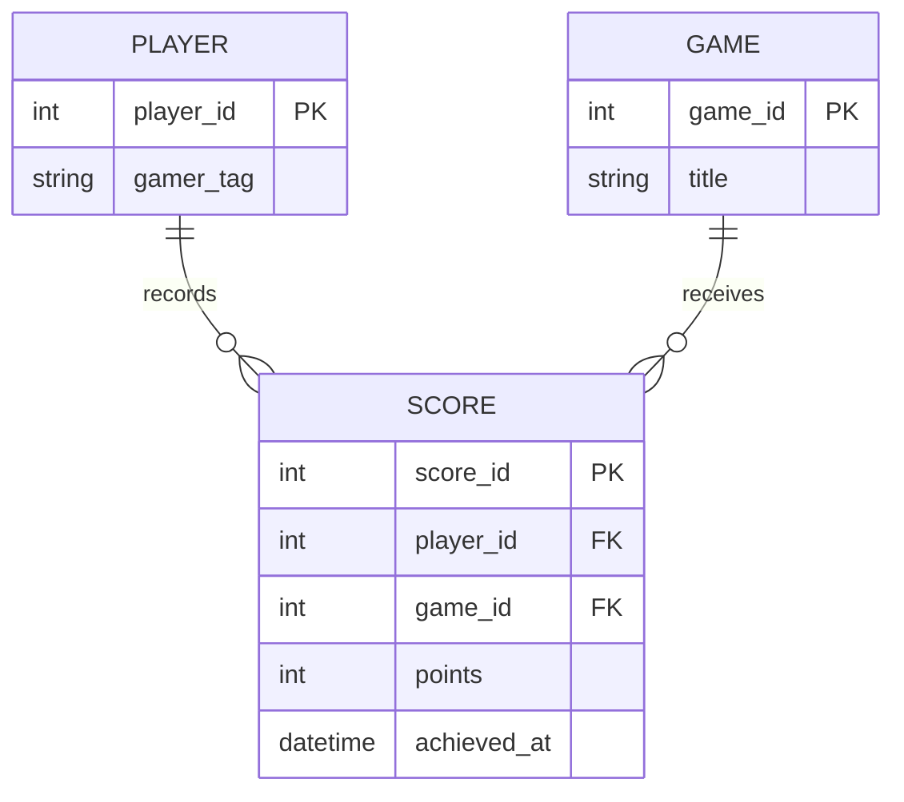

# 3.7 Introduction to entity relationship diagrams

This is a supplemental video to help with the **entity relationship diagram (ERD)** required for the final project pitch. An ERD describes the data we need to retain and how its records relate. It helps us agree on the model before writing tables or database code.

## Start with requirements

In Class 2 we built a game-score app. Before storing scores in a database, we need to decide what a score belongs to. The diagram records those decisions.

Display these rules:

* A player can have zero or many scores.
* A game can have zero or many scores.
* Each score belongs to exactly one player and exactly one game.
* A player can record several scores for the same game.

Underline Player, Game, and Score. These are entity types. “PixelNova” is an example of a player record, not a separate entity type.

## Boxes and keys

Draw three boxes with these attributes:

| Entity | Attributes |
|---|---|
| Player | `player_id` **PK**, `gamer_tag` |
| Game | `game_id` **PK**, `title` |
| Score | `score_id` **PK**, `player_id` **FK**, `game_id` **FK**, `points`, `achieved_at` |

A **primary key** uniquely identifies a record and cannot be null. A **foreign key** references a key in another table (or the same table in a self-relationship). Here Score's player and game IDs reference their primary keys. Names make useful labels, but are not automatically unique or stable identifiers.

Show two sample Score records:

| score_id | player_id | game_id | points | achieved_at |
|---|---|---|---|---|
| 101 | 7 | 3 | 1200 | 2026-09-08 10:00 |
| 102 | 7 | 3 | 1500 | 2026-09-08 11:00 |

Both can belong to the same player and game. Therefore, do not make `(player_id, game_id)` unique in this model. The individual score ID distinguishes repeated attempts.

## Cardinality and optionality

Cardinality expresses how many records can participate. Optionality expresses whether zero is allowed. Use these minimum/maximum labels while drawing:

| Label | Meaning |
|---|---|
| `1..1` | Exactly one |
| `0..1` | Zero or one |
| `0..*` | Zero or many |
| `1..*` | One or many |

In crow's-foot notation, a circle means zero, a bar means one, and the fork means many. Read each endpoint as the permitted number of records at that end for one record at the opposite end.

One player may have zero or many scores. One score must have exactly one player. A player with no scores is valid; a score with no player is not. In a later database implementation, non-null foreign keys help enforce Score's required parents.

The lines here communicate cardinality. Identifying versus non-identifying relationship line styles vary by diagram tool and are outside this introductory video.

## Many-to-many relationships

Players and games have a many-to-many relationship through Score: one player can score in many games, and one game can have many players. Score is an **associative entity** that also records facts about the relationship.

Contrast this with joining projects. A User can join many Projects; a Project can have many Users. A ProjectMember entity can store `user_id`, `project_id`, and `role`. If each user may join a particular project only once, make that pair unique (or use it as a composite primary key). This is a different rule from repeated scores.

For zero-or-one, consider a User with an optional Profile. Each Profile belongs to exactly one User; each User has zero or one Profile. Making Profile's user ID both its primary key and a foreign key prevents two profiles for the same user. A foreign key alone does not enforce the “at most one” part.

## Connect the diagram to PHP

A PHP Score object might hold Player and Game object references. A database Score row stores their IDs. The concepts correspond, but the representations differ.

An ERD describes stored data and relationships; a UML class diagram also describes behavior and inheritance. A User-to-Project relationship does **not** mean `Project extends User`. It means a project refers to a user, perhaps its owner. Do not translate every foreign key into inheritance.

For the final project pitch, practice the same process:

1. Read each feature and identify the facts that must be stored.
2. Name the entities and choose primary keys.
3. Write both directions of every relationship as sentences.
4. Record minimum and maximum participation.
5. Resolve many-to-many relationships with associative entities.
6. Add foreign keys and any uniqueness rules the requirements need.

Keep player details in Player, rather than repeating them in every Score. That avoids inconsistent copies when a name changes. Detailed normalization, SQL, indexes, and delete strategies belong to later database work.
